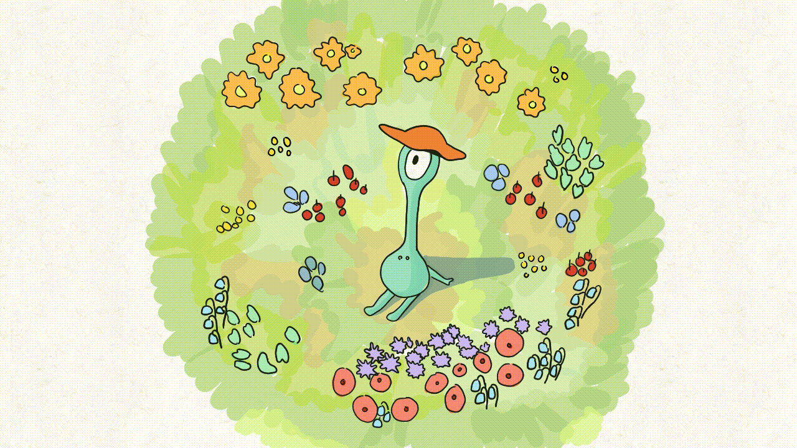
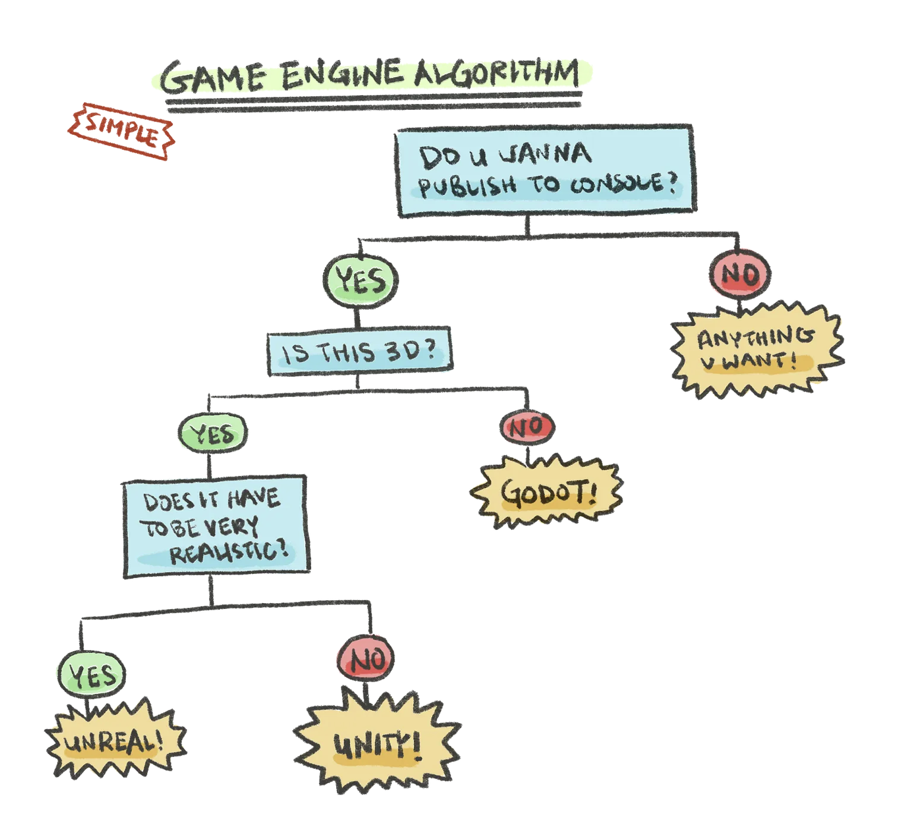

# Halmi: The Evolution of Our Game So far
## 2026/06/07

To me, a good game is like a good animated movie. When it’s really good, it sticks in my head for weeks. I find myself wondering how they made it, how they came up with the concept, who are creators, and who are their parents haha.. It goes on and on and on. I think about strategies, plot twists, different interpretations, what could have been done better. That's where my admiration started. And then I decided to give it a try myself. I realized that I was a bit more optimistic about the work but I'm very happy that it exists and is still WIP.
I'd like to write here a little bit about what decisions we made, the progress of our game and some lessons learned.

## Some major decisions
Our checklist was simple. It had to support 3D, have a ton of community content and tutorials we could follow online, and it doesn't cost a shit ton of money. Looking at all those boxes, Unity was the best fit. Godot is a good, open source alternative (that's free!) if it makes more sense to make a 2D game especially.

For 3D modeling, I decided to learn & use Blender. It's a fascinating tool. Its physics engine is very impressive but we don't actually need it for our game, especially since it takes a lot of compute. However, we've focused on using it for modeling and animating the objects in the game. While there are some pretty decent AI 3D modeling tools out there right now, the technology still isn't quite where it needs to be for game development. The biggest issue is that AI-generated models are quite messy. For a performant game, keeping the face count and topology tight is critical. Learning Blender myself ensures I have complete control over our meshes and performance.

  <video width="500" style="max-width: 100%;" controls>
    <source src="/src/assets/photos/blender.mp4" type="video/mp4">
    Your browser does not support the video tag.
  </video>

We used Shader Graph for pretty much all of our shader-related tasks. Shader programming to me has been brutal to debug and terrifying to look at. Shader Graph at least gives us a visual way to see what’s going on, which makes troubleshooting a bit less painful.

## Progress
### Version 1
We were initially drawn to the idea of a randomly generated world by its promise of near-infinite playability. What we found is that walking around our initial, naively generated world became boring after 30 seconds. We put a fair bit of work trying to make it more interesting: we added biomes, worked on generating more diverse terrain, and modeled different types of plants. And it was way more interesting! But humans are very, very good at finding patterns in the noise and even with these additions the world started to feel repetitive after five minutes or so of wandering. We could have continued down that path and made even more complex and interesting nature, perhaps with little villages or buildings to stumble upon, but that is not the game we set out to make. We want our game to provide many fun, strategy-filled hours! Given our limitations, we cannot pour effort into building out an interesting world and still have time left over to draft mechanisms that we’ll be proud of.

  <video width="500" style="max-width: 100%;" controls>
    <source src="/src/assets/photos/game_v1.mp4" type="video/mp4">
    Your browser does not support the video tag.
  </video>

### Version 2
So we decided to scope down a little bit. Instead of infinite, procedurally generated environment, we decided to pivot to a more constrained world. This constraint actually freed us up to focus on what we care about most: deep strategy and fascinating game mechanics. For example, we love Slay the Spire and Starcraft. Drawing inspiration from them, we’ve landed on our core concept: a real-time strategy game using deck-building and card mechanics. It's still WIP but it's a lot more fun to play already. We've been playing at least 20 minutes, which we realized it's a big milestone.

  <video width="500" style="max-width: 100%;" controls>
    <source src="/src/assets/photos/game_v2.mp4" type="video/mp4">
    Your browser does not support the video tag.
  </video>

## Lessons Learned
1. **Scope is everything**: There’s always a tradeoff. If you want to build a massive, Minecraft-meets-Animal-Crossing universe, it requires an immense amount of time, effort, and money. Developing a sharp instinct for the right scope relative to your actual resources is a valuable skill.
2. **Mechanics first, aesthetics second**: It’s vital to nail the core game loops and mechanics before getting bogged down in the visual polish. Playable over pretty, always.
3. **Over-communicate**: Clear, proactive communication reduces unnecessary friction.
4. **Be kind to yourself**: Creating something from nothing is HARD. It is essential to practice empathy and gentleness—both toward yourself and the people you are building with.
5. **It's okay to pause sometimes**: It's okay to step back and reflect. It helps to shift focus to other priorities, and gain the distance you need to ensure you’re still moving in the right direction.